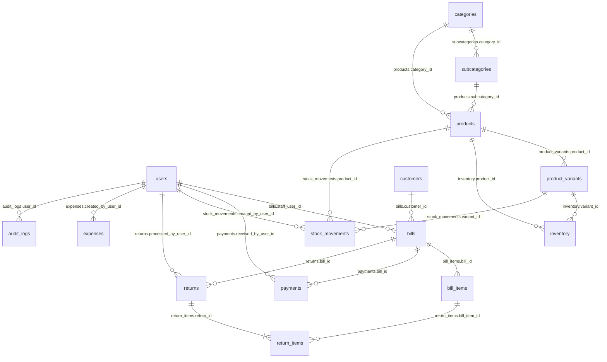

# VIYON Billing System - Complete Database Architecture & Design Document

## 1. Architectural Overview

The **VIYON Billing System** is designed for a physical retail clothing store located in Sathyamangalam, Tamil Nadu, specializing in **MEN'S & KID'S WEAR**. The database is built on **Neon PostgreSQL (v16+)**, driven by **Python 3.12**, **SQLAlchemy 2.x**, **Alembic**, and the **Psycopg 3** driver.

```
       +-------------------------------------------------------------+
       |                  VIYON STORE ARCHITECTURE                   |
       +-------------------------------------------------------------+
                                      |
                     +--------------------------------+
                     | Neon Serverless PostgreSQL 16+ |
                     |   (Connection Pooler / SSL)    |
                     +--------------------------------+
                                      |
                     +--------------------------------+
                     | SQLAlchemy 2.0 + Psycopg 3     |
                     |  - Pre-ping connection check   |
                     |  - Pool recycling (300s)       |
                     |  - Strict CHECK constraints    |
                     |  - Compound Foreign Keys       |
                     |  - Partial Unique Indexes      |
                     +--------------------------------+
```

### Core Design Principles

1. **Physical Store In-Store Payment Workflow**:
   - Customers pay directly by scanning the store's physical UPI QR code (Google Pay, PhonePe, Paytm, BHIM) or in cash.
   - **No payment gateway or online checkout is integrated.**
   - Staff manually verifies the payment notification before recording it.
   - Payments support Cash, UPI, and Split Payments (Cash + UPI).
   - Bills are only marked `PAID` when the total confirmed payments equal or exceed the bill total.
2. **Immutable Financial History & Snapshots**:
   - When a bill is created, product details (name, SKU, size, color, unit price) are frozen into snapshot fields in `bill_items`.
   - Modifying or archiving products never alters past sales receipts or historical reporting.
   - Soft deletion / archiving (`is_archived`) is enforced for catalog management.
3. **Compound Foreign Key Validation**:
   - Subcategories are strictly tied to categories at the database engine level via a compound constraint `(subcategory_id, category_id)` referencing `subcategories(id, category_id)`.
4. **Partial Unique Indexes for Polymorphic Inventory**:
   - Both simple products and variant products share the unified `inventory` table.
   - Partial unique indexes prevent duplicate stock records while allowing NULL variants for simple items.
5. **Auditable Inventory Movement Ledger**:
   - Every sale, return, manual adjustment, or stock replenishment records an auditable `stock_movements` ledger entry.
   - Inventory quantity updates and stock movement entries are executed in the same atomic database transaction.

---

## 2. Entity-Relationship Diagram (ERD)



---

## 3. Database Schema Catalog (17 Tables)

### 3.1. `users`
**Purpose**: Authentication and role-based authorization for store owner and billing staff.
- `id` (UUID, PK, default `gen_random_uuid()`)
- `full_name` (VARCHAR(255), NOT NULL)
- `email` (VARCHAR(255), UNIQUE, NOT NULL, INDEX)
- `password_hash` (VARCHAR(255), NOT NULL) - Securely hashed (e.g. bcrypt / argon2)
- `role` (VARCHAR(20), NOT NULL, DEFAULT `'STAFF'`)
  - **CHECK**: `role IN ('OWNER', 'STAFF')`
- `is_active` (BOOLEAN, NOT NULL, DEFAULT `TRUE`)
- `created_at` (TIMESTAMPTZ, NOT NULL, DEFAULT `now()`)
- `updated_at` (TIMESTAMPTZ, NOT NULL, DEFAULT `now()`)

---

### 3.2. `store_settings`
**Purpose**: Official store information, tax defaults, and thermal printer receipt layout.
- `id` (UUID, PK, default `gen_random_uuid()`)
- `store_name` (VARCHAR(255), NOT NULL, DEFAULT `'VIYON'`)
- `tagline` (VARCHAR(255), DEFAULT `'MEN''S | KID''S WEAR'`)
- `logo_url` (VARCHAR(1024), NULLABLE)
- `address` (TEXT, NOT NULL, DEFAULT `'F6WR+R8W, South Rangasamuthram, North Rangasamuthram, Sathyamangalam, Tamil Nadu 638402'`)
- `phone` (VARCHAR(50), NOT NULL, DEFAULT `'082702 42681'`)
- `email` (VARCHAR(255), NULLABLE)
- `gstin` (VARCHAR(20), NULLABLE)
- `receipt_footer` (TEXT, DEFAULT `'Thank you for shopping at VIYON! Visit again.'`)
- `currency_code` (VARCHAR(10), NOT NULL, DEFAULT `'INR'`)
- `tax_enabled` (BOOLEAN, NOT NULL, DEFAULT `FALSE`)
- `default_tax_rate` (NUMERIC(5,2), NOT NULL, DEFAULT `0.00`)
  - **CHECK**: `default_tax_rate >= 0 AND default_tax_rate <= 100`
- `receipt_width_mm` (INTEGER, NOT NULL, DEFAULT `58`)
  - **CHECK**: `receipt_width_mm IN (58, 80)`
- `is_active_config` (BOOLEAN, NOT NULL, DEFAULT `TRUE`)
- `updated_at` (TIMESTAMPTZ, NOT NULL, DEFAULT `now()`)
- **INDEX**: Partial Unique Index `uq_store_settings_single_active` on `(is_active_config)` where `is_active_config IS TRUE`.

---

### 3.3. `categories`
**Purpose**: Top-level product groupings created by the store owner (e.g. Men's Wear, Kids' Wear).
- `id` (UUID, PK, default `gen_random_uuid()`)
- `name` (VARCHAR(100), UNIQUE, NOT NULL, INDEX)
- `description` (TEXT, NULLABLE)
- `is_active` (BOOLEAN, NOT NULL, DEFAULT `TRUE`)
- `created_at` (TIMESTAMPTZ, NOT NULL, DEFAULT `now()`)
- `updated_at` (TIMESTAMPTZ, NOT NULL, DEFAULT `now()`)

---

### 3.4. `subcategories`
**Purpose**: Subcategories linked to a parent category (e.g. Formal Shirts, T-Shirts, Jeans).
- `id` (UUID, PK, default `gen_random_uuid()`)
- `category_id` (UUID, NOT NULL, FK to `categories.id` ON DELETE `RESTRICT`, INDEX)
- `name` (VARCHAR(100), NOT NULL)
- `description` (TEXT, NULLABLE)
- `is_active` (BOOLEAN, NOT NULL, DEFAULT `TRUE`)
- `created_at` (TIMESTAMPTZ, NOT NULL, DEFAULT `now()`)
- `updated_at` (TIMESTAMPTZ, NOT NULL, DEFAULT `now()`)
- **CONSTRAINTS**:
  - `uq_subcategories_category_name`: UNIQUE `(category_id, name)`
  - `uq_subcategories_id_category_id`: UNIQUE `(id, category_id)` for compound FK verification

---

### 3.5. `products`
**Purpose**: Main product catalog holding base prices, category references, and status flags.
- `id` (UUID, PK, default `gen_random_uuid()`)
- `product_name` (VARCHAR(255), NOT NULL, INDEX)
- `description` (TEXT, NULLABLE)
- `category_id` (UUID, NOT NULL, FK to `categories.id` ON DELETE `RESTRICT`, INDEX)
- `subcategory_id` (UUID, NULLABLE, INDEX)
- `brand` (VARCHAR(100), NULLABLE, INDEX)
- `product_image_url` (VARCHAR(1024), NULLABLE)
- `product_type` (VARCHAR(20), NOT NULL, DEFAULT `'SIMPLE'`)
  - **CHECK**: `product_type IN ('SIMPLE', 'VARIANT')`
- `base_price` (NUMERIC(12,2), NOT NULL)
  - **CHECK**: `base_price >= 0`
- `cost_price` (NUMERIC(12,2), NULLABLE)
  - **CHECK**: `cost_price IS NULL OR cost_price >= 0`
- `is_active` (BOOLEAN, NOT NULL, DEFAULT `TRUE`, INDEX)
- `is_archived` (BOOLEAN, NOT NULL, DEFAULT `FALSE`, INDEX)
- `created_at` (TIMESTAMPTZ, NOT NULL, DEFAULT `now()`)
- `updated_at` (TIMESTAMPTZ, NOT NULL, DEFAULT `now()`)
- **COMPOUND FOREIGN KEY**: `fk_products_subcategory_category` on `(subcategory_id, category_id)` REFERENCES `subcategories(id, category_id)` ON DELETE `RESTRICT`.

---

### 3.6. `product_variants`
**Purpose**: Clothing sizes (S, M, L, XL, XXL, etc.), colors, dedicated SKU codes, and barcodes.
- `id` (UUID, PK, default `gen_random_uuid()`)
- `product_id` (UUID, NOT NULL, FK to `products.id` ON DELETE `CASCADE`, INDEX)
- `size` (VARCHAR(50), NOT NULL)
- `color` (VARCHAR(50), NOT NULL)
- `sku` (VARCHAR(100), UNIQUE, NOT NULL, INDEX)
- `barcode` (VARCHAR(100), UNIQUE, NULLABLE, INDEX)
- `price_override` (NUMERIC(12,2), NULLABLE)
  - **CHECK**: `price_override IS NULL OR price_override >= 0`
- `is_active` (BOOLEAN, NOT NULL, DEFAULT `TRUE`)
- `created_at` (TIMESTAMPTZ, NOT NULL, DEFAULT `now()`)
- `updated_at` (TIMESTAMPTZ, NOT NULL, DEFAULT `now()`)
- **CONSTRAINTS**: UNIQUE `(product_id, size, color)`

---

### 3.7. `inventory`
**Purpose**: Real-time on-hand stock quantities and low-stock notification triggers.
- `id` (UUID, PK, default `gen_random_uuid()`)
- `product_id` (UUID, NOT NULL, FK to `products.id` ON DELETE `RESTRICT`, INDEX)
- `variant_id` (UUID, NULLABLE, FK to `product_variants.id` ON DELETE `RESTRICT`, INDEX)
- `quantity` (INTEGER, NOT NULL, DEFAULT `0`)
  - **CHECK**: `quantity >= 0` (Prevents negative stock)
- `low_stock_threshold` (INTEGER, NOT NULL, DEFAULT `5`)
  - **CHECK**: `low_stock_threshold >= 0`
- `updated_at` (TIMESTAMPTZ, NOT NULL, DEFAULT `now()`)
- **INDEXES**:
  - `uq_inventory_simple_product`: UNIQUE `(product_id)` WHERE `variant_id IS NULL`
  - `uq_inventory_variant`: UNIQUE `(variant_id)` WHERE `variant_id IS NOT NULL`

---

### 3.8. `customers`
**Purpose**: Optional customer profiles for loyalty and receipt dispatch. Walk-in customers do not require an account.
- `id` (UUID, PK, default `gen_random_uuid()`)
- `customer_name` (VARCHAR(255), NOT NULL)
- `phone` (VARCHAR(20), NOT NULL, INDEX)
- `email` (VARCHAR(255), NULLABLE)
- `address` (TEXT, NULLABLE)
- `created_at` (TIMESTAMPTZ, NOT NULL, DEFAULT `now()`)
- `updated_at` (TIMESTAMPTZ, NOT NULL, DEFAULT `now()`)

---

### 3.9. `bills`
**Purpose**: Main sales billing transaction headers.
- `id` (UUID, PK, default `gen_random_uuid()`)
- `bill_number` (VARCHAR(50), UNIQUE, NOT NULL, INDEX)
- `customer_id` (UUID, NULLABLE, FK to `customers.id` ON DELETE `SET NULL`, INDEX)
- `staff_user_id` (UUID, NOT NULL, FK to `users.id` ON DELETE `RESTRICT`, INDEX)
- `bill_date` (TIMESTAMPTZ, NOT NULL, DEFAULT `now()`, INDEX)
- `subtotal` (NUMERIC(12,2), NOT NULL)
  - **CHECK**: `subtotal >= 0`
- `discount_amount` (NUMERIC(12,2), NOT NULL, DEFAULT `0.00`)
  - **CHECK**: `discount_amount >= 0`
- `tax_amount` (NUMERIC(12,2), NOT NULL, DEFAULT `0.00`)
  - **CHECK**: `tax_amount >= 0`
- `total_amount` (NUMERIC(12,2), NOT NULL)
  - **CHECK**: `total_amount >= 0`
- `amount_paid` (NUMERIC(12,2), NOT NULL, DEFAULT `0.00`)
  - **CHECK**: `amount_paid >= 0`
- `balance_amount` (NUMERIC(12,2), NOT NULL)
  - **CHECK**: `balance_amount >= 0`
- `payment_status` (VARCHAR(30), NOT NULL, DEFAULT `'PENDING'`, INDEX)
  - **CHECK**: `payment_status IN ('PENDING', 'PARTIALLY_PAID', 'PAID', 'REFUNDED')`
- `bill_status` (VARCHAR(30), NOT NULL, DEFAULT `'COMPLETED'`, INDEX)
  - **CHECK**: `bill_status IN ('DRAFT', 'COMPLETED', 'CANCELLED')`
- `notes` (TEXT, NULLABLE)
- `created_at` (TIMESTAMPTZ, NOT NULL, DEFAULT `now()`)
- `updated_at` (TIMESTAMPTZ, NOT NULL, DEFAULT `now()`)

---

### 3.10. `bill_items`
**Purpose**: Individual items purchased in a bill with permanent historical snapshots.
- `id` (UUID, PK, default `gen_random_uuid()`)
- `bill_id` (UUID, NOT NULL, FK to `bills.id` ON DELETE `RESTRICT`, INDEX)
- `product_id` (UUID, NULLABLE, FK to `products.id` ON DELETE `SET NULL`, INDEX)
- `variant_id` (UUID, NULLABLE, FK to `product_variants.id` ON DELETE `SET NULL`, INDEX)
- `product_name_snapshot` (VARCHAR(255), NOT NULL)
- `sku_snapshot` (VARCHAR(100), NOT NULL)
- `size_snapshot` (VARCHAR(50), NULLABLE)
- `color_snapshot` (VARCHAR(50), NULLABLE)
- `quantity` (INTEGER, NOT NULL)
  - **CHECK**: `quantity > 0`
- `unit_price` (NUMERIC(12,2), NOT NULL)
  - **CHECK**: `unit_price >= 0`
- `discount_amount` (NUMERIC(12,2), NOT NULL, DEFAULT `0.00`)
  - **CHECK**: `discount_amount >= 0`
- `tax_amount` (NUMERIC(12,2), NOT NULL, DEFAULT `0.00`)
  - **CHECK**: `tax_amount >= 0`
- `line_total` (NUMERIC(12,2), NOT NULL)
  - **CHECK**: `line_total >= 0`
- `created_at` (TIMESTAMPTZ, NOT NULL, DEFAULT `now()`)

---

### 3.11. `payments`
**Purpose**: Staff-confirmed in-store payments (Cash and physical QR-code UPI).
- `id` (UUID, PK, default `gen_random_uuid()`)
- `bill_id` (UUID, NOT NULL, FK to `bills.id` ON DELETE `RESTRICT`, INDEX)
- `payment_method` (VARCHAR(20), NOT NULL)
  - **CHECK**: `payment_method IN ('CASH', 'UPI')`
- `amount` (NUMERIC(12,2), NOT NULL)
  - **CHECK**: `amount > 0`
- `payment_status` (VARCHAR(30), NOT NULL, DEFAULT `'PENDING'`, INDEX)
  - **CHECK**: `payment_status IN ('PENDING', 'CONFIRMED', 'FAILED', 'REFUNDED')`
- `transaction_reference` (VARCHAR(100), NULLABLE, INDEX) - Optional UPI reference ID (UTR)
- `received_by_user_id` (UUID, NOT NULL, FK to `users.id` ON DELETE `RESTRICT`, INDEX)
- `received_at` (TIMESTAMPTZ, NOT NULL, DEFAULT `now()`)
- `notes` (TEXT, NULLABLE)
- `created_at` (TIMESTAMPTZ, NOT NULL, DEFAULT `now()`)

---

### 3.12. `stock_movements`
**Purpose**: Immutable transaction ledger for all inventory adjustments.
- `id` (UUID, PK, default `gen_random_uuid()`)
- `product_id` (UUID, NOT NULL, FK to `products.id` ON DELETE `RESTRICT`, INDEX)
- `variant_id` (UUID, NULLABLE, FK to `product_variants.id` ON DELETE `RESTRICT`, INDEX)
- `movement_type` (VARCHAR(30), NOT NULL, INDEX)
  - **CHECK**: `movement_type IN ('PURCHASE', 'SALE', 'RETURN', 'ADJUSTMENT')`
- `quantity_change` (INTEGER, NOT NULL)
  - **CHECK**: `quantity_change != 0`
- `reference_type` (VARCHAR(50), NOT NULL) - e.g. `'BILL'`, `'RETURN'`, `'PURCHASE'`, `'MANUAL'`
- `reference_id` (UUID, NULLABLE, INDEX)
- `notes` (TEXT, NULLABLE)
- `created_by_user_id` (UUID, NOT NULL, FK to `users.id` ON DELETE `RESTRICT`, INDEX)
- `created_at` (TIMESTAMPTZ, NOT NULL, DEFAULT `now()`, INDEX)

---

### 3.13. `returns`
**Purpose**: Customer returns and refunds header.
- `id` (UUID, PK, default `gen_random_uuid()`)
- `return_number` (VARCHAR(50), UNIQUE, NOT NULL, INDEX)
- `bill_id` (UUID, NOT NULL, FK to `bills.id` ON DELETE `RESTRICT`, INDEX)
- `processed_by_user_id` (UUID, NOT NULL, FK to `users.id` ON DELETE `RESTRICT`, INDEX)
- `return_date` (TIMESTAMPTZ, NOT NULL, DEFAULT `now()`)
- `total_refund_amount` (NUMERIC(12,2), NOT NULL)
  - **CHECK**: `total_refund_amount >= 0`
- `reason` (TEXT, NOT NULL)
- `status` (VARCHAR(30), NOT NULL, DEFAULT `'PENDING'`, INDEX)
  - **CHECK**: `status IN ('PENDING', 'COMPLETED', 'CANCELLED')`
- `created_at` (TIMESTAMPTZ, NOT NULL, DEFAULT `now()`)

---

### 3.14. `return_items`
**Purpose**: Individual items being returned with restock tracking.
- `id` (UUID, PK, default `gen_random_uuid()`)
- `return_id` (UUID, NOT NULL, FK to `returns.id` ON DELETE `CASCADE`, INDEX)
- `bill_item_id` (UUID, NOT NULL, FK to `bill_items.id` ON DELETE `RESTRICT`, INDEX)
- `quantity` (INTEGER, NOT NULL)
  - **CHECK**: `quantity > 0`
- `refund_amount` (NUMERIC(12,2), NOT NULL)
  - **CHECK**: `refund_amount >= 0`
- `restock` (BOOLEAN, NOT NULL, DEFAULT `TRUE`)
- `created_at` (TIMESTAMPTZ, NOT NULL, DEFAULT `now()`)

---

### 3.15. `discounts`
**Purpose**: Store promotions, seasonal discounts, and owner-defined coupon codes.
- `id` (UUID, PK, default `gen_random_uuid()`)
- `name` (VARCHAR(100), NOT NULL)
- `coupon_code` (VARCHAR(50), UNIQUE, NULLABLE, INDEX)
- `discount_type` (VARCHAR(20), NOT NULL)
  - **CHECK**: `discount_type IN ('PERCENTAGE', 'FIXED')`
- `discount_value` (NUMERIC(12,2), NOT NULL)
  - **CHECK**: `discount_value > 0`
- `minimum_order_value` (NUMERIC(12,2), NOT NULL, DEFAULT `0.00`)
  - **CHECK**: `minimum_order_value >= 0`
- `maximum_discount` (NUMERIC(12,2), NULLABLE)
  - **CHECK**: `maximum_discount IS NULL OR maximum_discount >= 0`
- `start_date` (TIMESTAMPTZ, NULLABLE)
- `end_date` (TIMESTAMPTZ, NULLABLE)
  - **CHECK**: `end_date IS NULL OR start_date IS NULL OR end_date >= start_date`
- `is_active` (BOOLEAN, NOT NULL, DEFAULT `TRUE`)
- `created_at` (TIMESTAMPTZ, NOT NULL, DEFAULT `now()`)
- `updated_at` (TIMESTAMPTZ, NOT NULL, DEFAULT `now()`)

---

### 3.16. `expenses`
**Purpose**: Operational store expense tracking (rent, electricity, packaging, maintenance).
- `id` (UUID, PK, default `gen_random_uuid()`)
- `expense_title` (VARCHAR(255), NOT NULL)
- `category` (VARCHAR(100), NOT NULL, INDEX)
- `amount` (NUMERIC(12,2), NOT NULL)
  - **CHECK**: `amount > 0`
- `expense_date` (TIMESTAMPTZ, NOT NULL, DEFAULT `now()`, INDEX)
- `description` (TEXT, NULLABLE)
- `created_by_user_id` (UUID, NOT NULL, FK to `users.id` ON DELETE `RESTRICT`, INDEX)
- `created_at` (TIMESTAMPTZ, NOT NULL, DEFAULT `now()`)

---

### 3.17. `audit_logs`
**Purpose**: System activity logging and audit trail for compliance and price change tracing.
- `id` (UUID, PK, default `gen_random_uuid()`)
- `user_id` (UUID, NULLABLE, FK to `users.id` ON DELETE `SET NULL`, INDEX)
- `action` (VARCHAR(100), NOT NULL, INDEX) - e.g. `'PRODUCT_UPDATE'`, `'BILL_CANCELLED'`, `'PRICE_OVERRIDE'`
- `entity_type` (VARCHAR(100), NOT NULL, INDEX)
- `entity_id` (UUID, NOT NULL, INDEX)
- `old_values` (JSONB, NULLABLE)
- `new_values` (JSONB, NULLABLE)
- `ip_address` (VARCHAR(45), NULLABLE)
- `created_at` (TIMESTAMPTZ, NOT NULL, DEFAULT `now()`, INDEX)

---

## 4. Key Relationships and Integrity Rules

| Parent Table | Child Table | Relationship | On Delete | Business Reason |
| :--- | :--- | :--- | :--- | :--- |
| `categories` | `subcategories` | 1-to-Many | `RESTRICT` | Prevent removing categories with child subcategories. |
| `categories` | `products` | 1-to-Many | `RESTRICT` | Preserve product categorization integrity. |
| `subcategories` | `products` | 1-to-Many | `RESTRICT` | Compound key ensures subcategory matches product category. |
| `products` | `product_variants` | 1-to-Many | `CASCADE` | Variant belongs strictly to parent product. |
| `products` | `inventory` | 1-to-Many | `RESTRICT` | Stock records must not be deleted. |
| `product_variants`| `inventory` | 1-to-Many | `RESTRICT` | Stock records must not be deleted. |
| `customers` | `bills` | 1-to-Many | `SET NULL` | Customer deletion or anonymity never destroys bill history. |
| `users` | `bills` | 1-to-Many | `RESTRICT` | Cashier/staff accountability must remain intact. |
| `bills` | `bill_items` | 1-to-Many | `RESTRICT` | Line items form permanent tax invoices. |
| `bills` | `payments` | 1-to-Many | `RESTRICT` | Payment receipts must never be orphaned. |
| `bills` | `returns` | 1-to-Many | `RESTRICT` | Returns depend on original bill validity. |
| `returns` | `return_items` | 1-to-Many | `CASCADE` | Items are part of the return document. |
| `bill_items` | `return_items` | 1-to-Many | `RESTRICT` | Return items reference original bill line items. |
| `users` | `stock_movements` | 1-to-Many | `RESTRICT` | Full audit trail on stock adjustments. |

---

## 5. Security and Data Protection

1. **Credentials Management**:
   - `DATABASE_URL` is read strictly from `.env` via `pydantic-settings` / `python-dotenv`.
   - `.env` is explicitly ignored in `.gitignore`.
   - `.env.example` contains sanitized placeholders.
2. **Neon Serverless Optimization**:
   - `pool_pre_ping=True` handles serverless sleep/resume cycles seamlessly.
   - `pool_recycle=300` prevents stale pooled connections.
3. **No Demo Data Policy**:
   - The migration contains only the initial store settings for VIYON.
   - No mock users, sample products, or fake sales are inserted.
   - Owner registration is designed to occur via an administrative setup CLI or first-run initialization.

---

## 6. Architectural Boundary: Database Constraints vs. Transactional Service Logic

To ensure absolute financial and inventory integrity, responsibilities are clearly partitioned between PostgreSQL engine guarantees and backend service transactional boundaries:

### A. Database-Level Relational Guarantees (Engine Enforced)
- **Non-negative stock**: `inventory.quantity >= 0` check constraint immediately aborts any transaction attempting to oversell stock.
- **Polymorphic stock integrity**: Partial unique indexes guarantee exactly one stock record per simple product and per variant.
- **Categorical correctness**: Compound FK `(subcategory_id, category_id)` guarantees at the engine level that a product's subcategory must belong to its parent category.
- **Permanent Invoice Snapshots**: Historical bill line items are preserved as independent immutable snapshots. Modifying products never alters past invoices.
- **Delete Protection**: `ON DELETE RESTRICT` on bills, payments, and returns prevents historical records from being deleted.
- **Single Active Store Profile**: Partial unique index on `store_settings(is_active_config)` where `is_active_config IS TRUE` ensures only one store configuration is active.

### B. Application & Transactional Service Guarantees (Backend Enforced)
1. **Concurrent Billing Concurrency Protection**:
   - During checkout, the service locks the inventory row using `SELECT ... FROM inventory WHERE ... FOR UPDATE`.
   - Checks available stock against the requested quantity.
   - Atomically decrements `inventory.quantity` and inserts an auditable `stock_movements` record (`movement_type = 'SALE'`) in the same database transaction.
2. **Manual In-Store Payment Verification**:
   - Cashiers verify the physical UPI app confirmation on their store device.
   - Payment record is inserted as `payment_status = 'CONFIRMED'` (or `'PENDING'` if awaiting confirmation).
   - Only confirmed payments contribute to `bills.amount_paid`:
     $$\text{amount\_paid} = \sum \text{payments.amount WHERE payment\_status} = \text{'CONFIRMED'}$$
   - Balance is updated: $\text{balance\_amount} = \max(0, \text{total\_amount} - \text{amount\_paid})$.
   - Bill `payment_status` is updated to `'PAID'` strictly when $\text{amount\_paid} \ge \text{total\_amount}$.
3. **Return Quantity and Restock Protection**:
   - The return service locks the `bill_item` row.
   - Validates that $\text{return\_quantity} \le (\text{sold\_quantity} - \sum \text{completed\_previous\_returns})$.
   - Restocks inventory and generates a `stock_movements` record (`movement_type = 'RETURN'`) only if `restock == True`.
   - Never alters the original bill total; refunds are tracked independently in `returns` and refund payments.

---

## 7. Migration Revision Details

- **Revision ID**: `002e11099e78` (`initial_schema_viyon_billing.py`)
- **Status**: Tested offline with `alembic upgrade head --sql`. Verified 100% compliant with PostgreSQL 16+.
- **Downgrade Safety**: Protected with an explicit safety guard (`ALLOW_DESTRUCTIVE_DOWNGRADE=1`).
- **Seed Operation**: Idempotent insert with `ON CONFLICT (id) DO NOTHING`.
